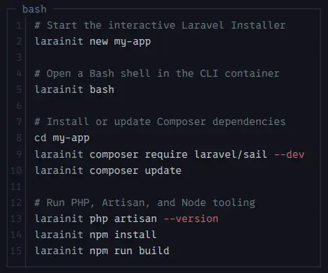

# Larainit

**A disposable, Docker-powered Laravel CLI toolchain. No local PHP, Composer, or Node.js required.**

Larainit runs the Laravel Installer and common development commands inside a temporary Docker container, while keeping your project files on your machine. Use it to bootstrap Laravel applications **before** installing Laravel Sail or setting up a project-specific Docker Compose stack.

**Build the toolchain once, then prefix your commands with `larainit`.** No local runtime setup, no toolchain files added to your application.



## Table of contents

- [Features](#features)
- [Requirements](#requirements)
- [Install](#install)
- [Quick start](#quick-start)
- [Usage](#usage)
  - [Command behavior](#command-behavior)
- [How it works](#how-it-works)
- [Larainit vs. Sail](#larainit-vs-sail)
- [Troubleshooting](#troubleshooting)
- [Scope](#scope)
- [License](#license)

## Features

- Create projects with the interactive **Laravel Installer** (`laravel new`), not `composer create-project`.
- Run **PHP, Composer, Node.js, npm, and Artisan** without installing their runtimes on the host.
- Open a shell with `larainit bash`.
- Mount your current directory into the container at `/workspace`.
- Run commands under your host UID/GID to avoid root-owned generated files on Linux.
- Keep project-specific Docker and Sail configuration separate from the bootstrap toolchain.

## Requirements

- Docker Engine (or a compatible Docker installation)
- Bash
- A Unix-like shell environment (Linux; macOS support may require adjustments)

## Install

Clone the repository and build the image:

```bash
git clone https://github.com/Mahmoud217TR/larainit.git
cd larainit
docker build -t larainit:latest .
```

Make the wrapper executable and place it somewhere on your `PATH`:

```bash
chmod +x larainit
mkdir -p ~/.local/bin
cp larainit ~/.local/bin/larainit
```

Ensure `~/.local/bin` is on your `PATH` (restart your shell if needed).

## Quick start

Once installed, create an application from any writable directory:

```bash
larainit new my-app
cd my-app
larainit npm install
larainit npm run build
```

Follow the installer's prompts to choose your application setup. Your project stays on your machine; each command's container is removed automatically when it finishes.

Already have a project? Just `cd` into it and run `larainit composer install` or `larainit php artisan --version`.

## Usage

Run commands **from the directory where you want to work**:

```bash
# Start the interactive Laravel Installer
larainit new my-app

# Open a Bash shell in the CLI container
larainit bash

# Install or update Composer dependencies
cd my-app
larainit composer require laravel/sail --dev
larainit composer update

# Run PHP, Artisan, and Node tooling
larainit php artisan --version
larainit npm install
larainit npm run build
```

### Command behavior

| Command | Runs in the container |
| --- | --- |
| `larainit new my-app` | `laravel new my-app` |
| `larainit bash` | `bash` |
| `larainit composer install` | `composer install` |
| `larainit npm install` | `npm install` |
| `larainit php artisan test` | `php artisan test` |

All other arguments are forwarded to the container as a command.

## How it works

Each invocation starts a **new, temporary container** from the `larainit:latest` image. The current host directory is bind-mounted to `/workspace`, and the container is removed after the command exits.

- **Persists:** files written inside `/workspace` (your project).
- **Does not persist by default:** changes outside `/workspace`, globally installed packages added at runtime, and temporary caches.
- **Does not automatically provide:** database, Redis, web server, exposed ports, or a Docker daemon inside the container.

Use Laravel Sail or your own Docker Compose setup for the application's actual development services. Installing Sail's Composer package is possible with Larainit, but starting Compose services requires access to the Docker daemon from the host or appropriately configured tooling.

## Larainit vs. Sail

**Larainit** is a project-independent bootstrap and CLI toolchain. **Laravel Sail** is a Docker Compose-based development environment for a Laravel application. They can complement one another; neither requires the other.

## Troubleshooting

**`laravel: Permission denied`** — Check that the Laravel Installer was installed in a shared path and that its executable and parent directories are accessible by your container user. Rebuild after changing the Dockerfile.

**`I have no name!` in Bash** — Your host UID might not have an `/etc/passwd` entry inside the container. This is generally a cosmetic shell prompt issue.

**File permission issues** — Verify that the wrapper uses your host UID/GID and that the bind-mounted directory is writable.

## Scope

Larainit is intentionally small: a repeatable Laravel bootstrap tool, not a replacement for project-specific container orchestration, CI/CD, or production deployments.

## License

Licensed under the [MIT License](LICENSE). You may use, modify, and distribute Larainit, including commercially, provided you retain the copyright and license notice.
